# Chef's Menu Manager: MAST5112 Final PoE

| | |
|---|---|
| **Student** | Noluthando Zondi (ST10531705) |
| **Institution** | IIE Rosebank International, Higher Certificate in Mobile Application and Web Development |
| **Module** | MAST5112 Mobile App Scripting |
| **GitHub repository** | https://github.com/NoluthandoZondiDev/Chef-menu-manager |
| **Final PoE video (unlisted)** | https://youtu.be/LZotG0eNqSU  |

---

The README for my Part 2 submission is kept at the bottom of this file: [jump to Part 2](#part-2-chefs-menu-manager-previous-submission).
   | **Part 2 video (earlier submission)** | https://youtu.be/BA3djBubITQ |

## 1. About the app

Chef's Menu Manager is an Android app built with React Native and Expo. It was made for a restaurant owner called Christoffel, whose chef used to keep the menu on paper. The chef can now add dishes, change them, remove them, find them quickly and see an overview of the whole menu from a phone.

Every dish stores four things: **dish name**, **description**, **course** (Starter, Main Course or Dessert) and **price**.

## 2. Features

- **Add a dish** with a form that checks every field and shows clear error messages
- **Choose from suggested dishes**: 15 ready made dishes the chef can tap to fill in the form, then change before saving
- **Edit a dish** using the same form, already filled in with the dish's details
- **Delete a dish** with a confirmation prompt first
- **Search** by dish name (not case sensitive, updates as you type)
- **Filter by course** (All, Starters, Mains, Desserts) and **clear** the search or filter to see the whole menu again
- **Menu statistics**: total dishes, average price and number of dishes per course
- **Menu is saved on the phone**, so the dishes are still there after the app is closed
- **Splash screen** with the app logo when the app opens
- **Helpful messages** for an empty menu, no search results, success and errors

## 3. Screenshots

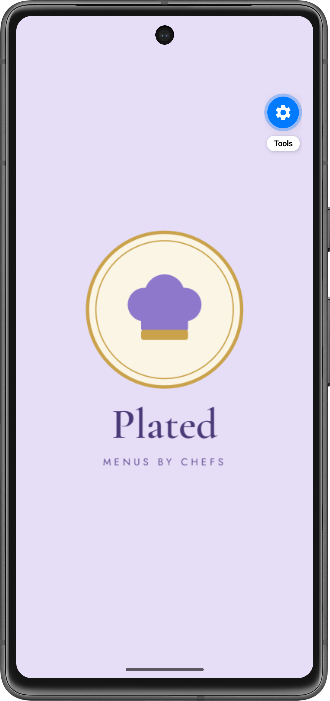
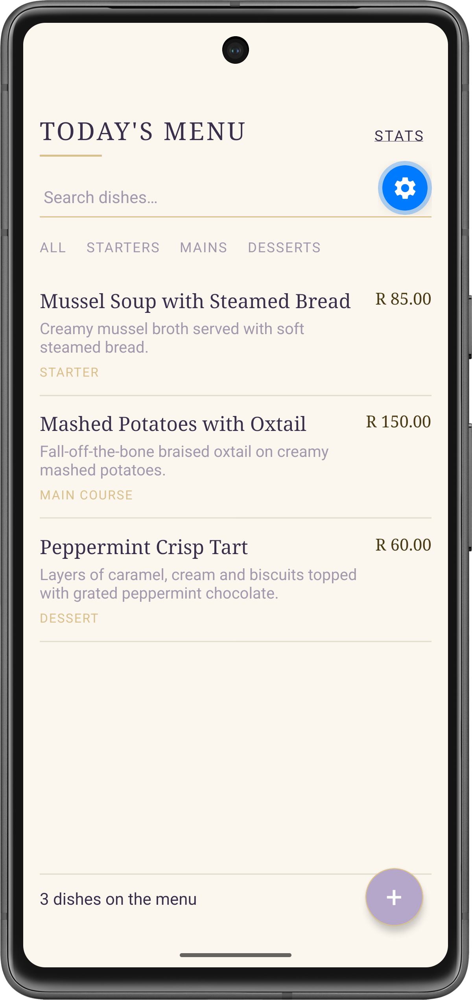
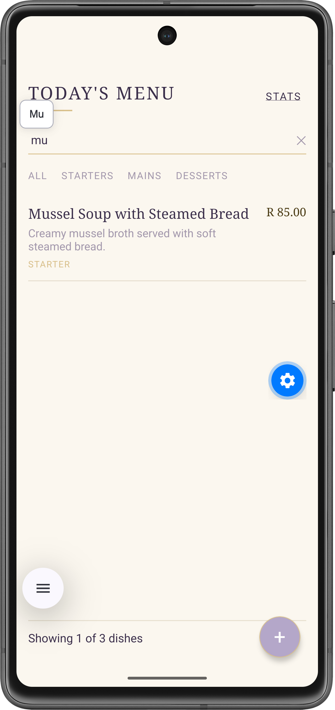
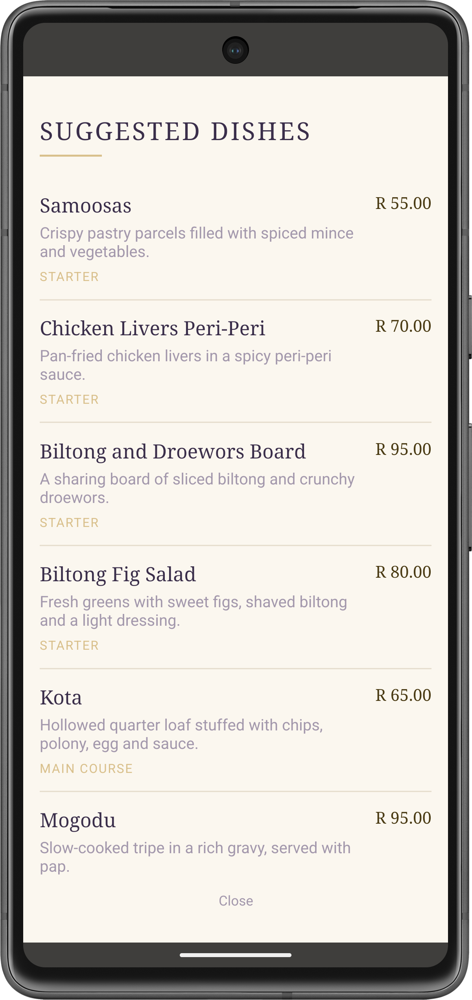
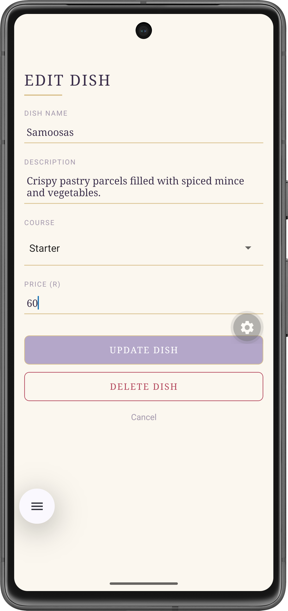
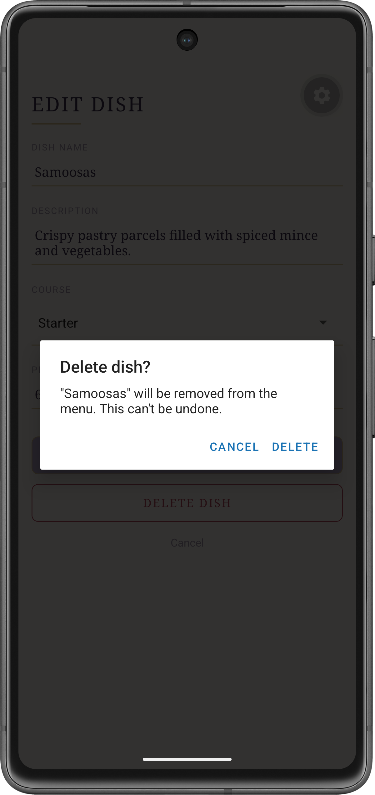
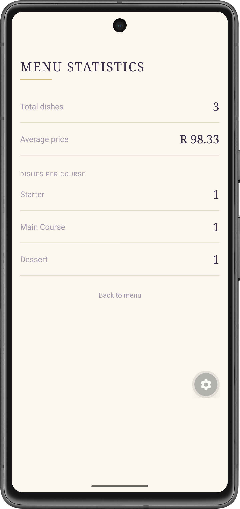

## 4. Technology used

The app is built with React Native components (Meta Platforms, Inc., n.d.) and runs through Expo (Expo, n.d.). Screens are connected with a native stack navigator (React Navigation, n.d.), and the menu is saved with Async Storage (React Native Community, n.d.).

| Library | What I used it for |
|---|---|
| `expo` | Running and building the project |
| `react-native` | The screens, lists, inputs and buttons |
| `@react-navigation/native` and `@react-navigation/native-stack` | Moving between Home, Add, Edit and Statistics |
| `react-native-screens` and `react-native-safe-area-context` | Native screens and keeping content clear of the status bar |
| `@react-native-picker/picker` | The course dropdown in the form |
| `@react-native-async-storage/async-storage` | Saving the menu on the phone |

## 5. How to run the project

1. Clone the repository
2. Open the folder in a terminal and run `npm install`
3. Start the project with `npx expo start -c`
4. Open it on an Android emulator by pressing `a`, or scan the QR code with Expo Go on an Android phone

## 6. Project structure

```
ChefMenuManager/
├── App.js                     navigation, menu state, add/update/delete, saving and loading
├── assets/                    app images, including the splash logo
├── components/
│   ├── DishForm.js            the form used by both Add and Edit
│   ├── DishRow.js             one dish in a list
│   ├── FilterRow.js           the All / Starters / Mains / Desserts row
│   ├── FormField.js           label + input + error message
│   ├── LogoSplash.js          the logo screen shown when the app opens
│   ├── PrimaryButton.js       the one button style (normal and delete)
│   ├── ScreenHeading.js       the heading with the gold underline
│   ├── SearchBar.js           search box with a clear button
│   ├── StatRow.js             one line on the statistics screen
│   └── SuggestedDishesModal.js  popup list of ready-made dishes
├── constants/
│   ├── courses.js             course names and the filter options
│   └── sampleDishes.js        the 15 suggested dishes
├── screens/
│   ├── HomeScreen.js          menu list, search, filter and count
│   ├── AddDishScreen.js       add a dish
│   ├── EditDishScreen.js      edit or delete a dish
│   └── StatsScreen.js         menu statistics
├── theme/colors.js            colours and fonts
├── utils/
│   ├── filterDishes.js        search and course filtering
│   ├── formatPrice.js         turns 95 into "R 95.00"
│   ├── menuStats.js           total, average and per-course counts
│   └── validateDish.js        validation rules and price parsing
└── screenshots/
```

---

## 7. Change log (Part 2 to Final PoE)

My Part 2 version was committed on 9 September 2026 (`9a1c603`). Everything below happened after that, starting on 28 October 2026. The dates and commit codes come from my Git commit history on GitHub, so every line can be checked against the repository.

Some steps appear in the history more than once (for example, edit and delete were added on 31 October and again on 3 November). That is because I redid those steps while reorganising the code, so I have listed the commit codes together.

### Timeline

| Date | Commit | What changed |
|---|---|---|
| 28 Oct 2026 | `99b6f49` | Removed template files before starting the Final PoE |
| 28 Oct 2026 | `2da9f92` | Shared list of course names (`COURSES`) |
| 28 to 29 Oct 2026 | `b80f7d0`, `eb26c38` | Helper functions for price formatting and validation |
| 29 Oct 2026 | `ef05821`, `dc73a50`, `cb941c9` | Reusable `ScreenHeading` and `PrimaryButton` components |
| 30 Oct 2026 | `ff6a0c9` | Added the Async Storage package for saving the menu |
| 31 Oct 2026 | `b869980` | Reusable `FormField`, `DishForm` and `DishRow` components |
| 31 Oct 2026 | `78f9992` | Add screen now uses the shared `DishForm` |
| 31 Oct 2026 | `2d17bfc`, `7de3a34` | Edit and delete a dish, update and delete handlers, and saving the menu with Async Storage |
| 1 Nov 2026 | `37fab98` | Async Storage package added to `package.json` and `package-lock.json` |
| 3 Nov 2026 | `50aa429` | Reusable `DishForm` with a check for duplicate dish names |
| 3 Nov 2026 | `57cf800` | Add screen now uses the shared `DishForm` |
| 3 Nov 2026 | `94f6f5a`, `62c1c86` | Edit and delete with a delete confirmation, rows open the Edit screen, update and delete handlers, menu saved with Async Storage |
| 3 Nov 2026 | `250b4e8` | Search bar, course filter row and the `filterDishes` helper |
| 4 Nov 2026 | `a111cac` | Reusable `StatRow` component |
| 4 Nov 2026 | `677c51d` | `getMenuStats` helper (total, average price, dishes per course) |
| 4 Nov 2026 | `45bc666` | Statistics screen with an empty-menu message and a back link |
| 4 Nov 2026 | `746a693` | Statistics screen added to the navigation |
| 4 Nov 2026 | `fc09282` | STATS link on Home |
| 4 Nov 2026 | `66496c5` | Sample dishes list |
| 4 Nov 2026 | `ff978bf` | `SuggestedDishesModal` component and the `actionLabel` option on `DishRow` |
| 4 Nov 2026 | `bc0140d` | Add screen can be pre-filled from a suggested dish |
| 4 Nov 2026 | `c17b9a2` | 15 preloaded South African dishes for the chef to choose from |
| 5 Nov 2026 | `fe5dab8` | Logo splash screen shown for about five seconds when the app opens |
| 5 Nov 2026 | `00f7473` | STATS link moved into the heading row and larger footer text on Home |

### Summary: new features
- **Edit screen:** tapping a dish on Home opens an Edit screen with the form already filled in. Saving updates the dish and Home shows the change straight away.
- **Delete:** a Delete button on the Edit screen asks "Delete dish?" before removing anything, then confirms with a message.
- **Search:** a search bar on Home filters the list by dish name as the chef types, ignoring capital letters.
- **Course filter:** a row of options (All, Starters, Mains, Desserts) shows only the chosen course. Search and filter work together.
- **Clear search and filter:** the X in the search bar clears the text, and a "Clear search and filter" link appears when nothing matches.
- **No-results message:** "No dishes match your search" shows when the search or filter finds nothing.
- **Footer count:** shows "Showing X of Y dishes" while searching or filtering, and the normal total otherwise.
- **Menu statistics screen:** shows the total number of dishes, the average price and the number of dishes in each course. A message shows instead if the menu is empty. It opens from the STATS link on Home.
- **Saved menu:** the menu is stored on the phone with Async Storage and loaded when the app opens.
- **Suggested dishes:** a link on the Add screen opens a list of 15 ready-made dishes. Tapping one fills in the form, and the chef can change anything before saving. Dishes already on the menu are hidden from the list.
- **Splash screen:** the app logo shows for about five seconds when the app opens, and nowhere else.

### Summary: improvements to existing features
- **Validation:** all the rules now live in one function used by Add and Edit. They check that the name is 2 to 40 characters, that the description is not empty and is 120 characters or fewer, that the price is a number above 0 and no more than R 9999.99, and that the dish name is not already on the menu (capital letters ignored). Prices typed with a comma, such as 95,50, are accepted.
- **Discard prompt:** pressing Cancel after typing or changing something asks "Discard changes?" first.
- **Keyboard handling:** forms scroll and stay usable while the keyboard is open.
- **Readability:** the dish count at the bottom of Home is bigger and darker, and the STATS link sits on the heading row instead of at the top edge of the screen.
- **Navigation and messages:** Add, Edit and Delete all return to Home with a clear success message.

### Summary: clean-up
- Removed template files that did not belong in the project.
- Removed duplicate files and folders and fixed screenshot file names.
- Rewrote my code comments so they explain what each part does.
- Used small commits with clear prefixes (`feat:`, `refactor:`, `fix:`, `chore:`, `style:`).

---

## 8. Refactoring notes

In Part 2, most of the code sat in two large screens, and the same pieces were written out again and again. For the Final PoE I split the code into small parts that each do one job, so Add and Edit could share the same form instead of having two copies.

### Before and after

| In Part 2 | In the Final PoE |
|---|---|
| `AddDishScreen.js` was about 200 lines. The label, input and error text was written out three times, once per field. | One `FormField` component is used for every field. |
| The heading and gold underline were copied onto each screen. | One `ScreenHeading` component is used on every screen. |
| Button styling was repeated. | One `PrimaryButton` component with a normal and a delete (danger) style. |
| Validation was written inside the Add screen. | One `validateDish` function that Add and Edit both use, so the rules can never differ. |
| Price formatting was done inline. | One `formatPrice` function used on Home, Edit and Statistics. |
| A dish row was written inside the Home screen. | A `DishRow` component, reused on Home and in the suggested dishes list. |
| Course names were typed as text in several files. | One `COURSES` list in `constants/courses.js`, used by the form, the filter row and the statistics. |
| The list of dishes could not be changed, only added to. | `App.js` now has `addMenuItem`, `updateMenuItem` and `deleteMenuItem`. |

### Reusable components
`DishForm`, `DishRow`, `FilterRow`, `FormField`, `LogoSplash`, `PrimaryButton`, `ScreenHeading`, `SearchBar`, `StatRow` and `SuggestedDishesModal`. Each one gets what it needs through props and does not know about the other screens.

### Reusable functions
- `validateDish` and `parsePrice` (validation and turning price text into a number)
- `formatPrice` (shows prices as "R 95.00" everywhere)
- `filterDishes` (search and course filter in one place)
- `getMenuStats` (total, average and per-course counts)

### Naming and organisation
- Files are grouped by job: `components`, `screens`, `utils`, `constants` and `theme`.
- Names say what the thing is or does, for example `handleUpdate`, `visibleDishes`, `otherDishNames` and `isFiltering`.
- The edit screen finds a dish by its id from the live menu, so it always shows the latest version.
- The menu is only saved after it has finished loading, so an empty list can never overwrite a saved menu.

---

## 9. Design

The design follows my Part 1 plan, a "lavender and champagne" look: a warm cream background, lavender buttons with a thin champagne outline, serif text for dish names and headings, and thin divider lines instead of boxed cards. Prices always appear in the same format (for example R 95.00).

| Use | Colour |
|---|---|
| Primary (buttons) | `#B4A7C9` |
| Background | `#FBF7EF` |
| Accent (outlines, course tags) | `#D9C08C` |
| Main text | `#3A2E4A` |
| Secondary text | `#A398AC` |
| Price text | `#4A3B14` |
| Error messages | `#B3455B` |
| Dividers | `#E4DCCB` |

## 10. Testing

I tested the app on an Android emulator (Pixel 7). Test cases:

| What I tried | What should happen |
|---|---|
| Open the app with no dishes | The empty-menu message shows |
| Press Save with empty fields | Error messages appear under the fields |
| Type letters or a negative number as the price | A price error shows |
| Add a dish with a name already on the menu | A duplicate error shows |
| Add a dish, then another from suggested dishes | Both appear on Home and the count goes up |
| Edit a dish and save | Home shows the new details straight away |
| Save a dish without changing its name | No duplicate error |
| Press Delete, then Cancel | Nothing is removed |
| Press Delete, then confirm | The dish disappears and the count goes down |
| Search for part of a name in lowercase | Matching dishes show |
| Choose each course filter | Only that course shows |
| Search for something that does not exist | The no-results message and clear link show |
| Open Statistics and compare with a calculator | The numbers match |
| Delete every dish and open Statistics | The empty-menu message shows |
| Close the app completely and reopen it | The dishes are still there |

---

## 11. AI usage disclosure

I used Duck.ai, an AI assistant made by DuckDuckGo, while working on this PoE. It helped me understand what was wrong with my code when my app kept crushing a nd my code had multiple errors. It also helped with structuring my folders to keep everything simple , clean, neat and organised,. It also helped me  put together this README to be so professional. I made the decisions about what the app should do and look like (the Part 1 design, the colours,the code, the dishes and prices, and the logo), and I can explain how each part of the code works.

---

## 12. Reference list

Expo (n.d.) *Expo documentation*. Available at: https://docs.expo.dev (Accessed: 5 November 2026).

Meta Platforms, Inc. (n.d.) *React Native documentation*. Available at: https://reactnative.dev/docs/getting-started (Accessed: 5 November 2026).

React Native Community (n.d.) *Async Storage*. Available at: https://react-native-async-storage.github.io/async-storage/ (Accessed: 5 November 2026).

React Navigation (n.d.) *React Navigation documentation*. Available at: https://reactnavigation.org/docs/getting-started (Accessed: 5 November 2026).

## Video Demonstration
FINAL POE YouTube video  submission:
https://youtu.be/LZotG0eNqSU

# Chef's Menu Manager — MAST5112 POE Part 2

**Student:** Noluthando Zondi
**Student Number:** ST10531705
**Module:** MAST5112 — Mobile App Scripting

## About This App

A React Native (Expo) mobile application built for Christoffel, a restaurant owner, to help manage his menu digitally instead of on paper. This is the Part 2 submission — the first working version of the app.

## Features Implemented in This Version

- Add new menu items (Dish Name, Description, Course, Price)
- View all menu items in a scrollable list, updating automatically as dishes are added
- Field validation with clear error messages for empty or invalid input
- Success confirmation when a dish is added
- Empty-state message when no dishes have been added yet
- Consistent design system throughout (lavender & champagne palette, carried over from Part 1)

*Note: editing, deleting, searching, filtering, and menu statistics are intentionally not included in this version — those are planned for the Final PoE.*

## Screenshots

### Home Screen — Today's Menu
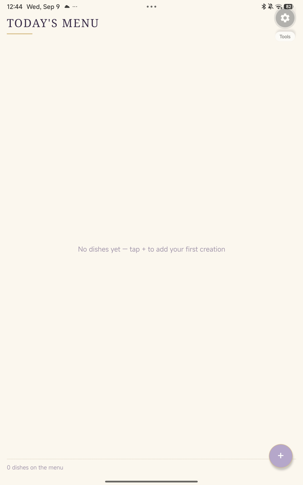

### Add a Dish Screen
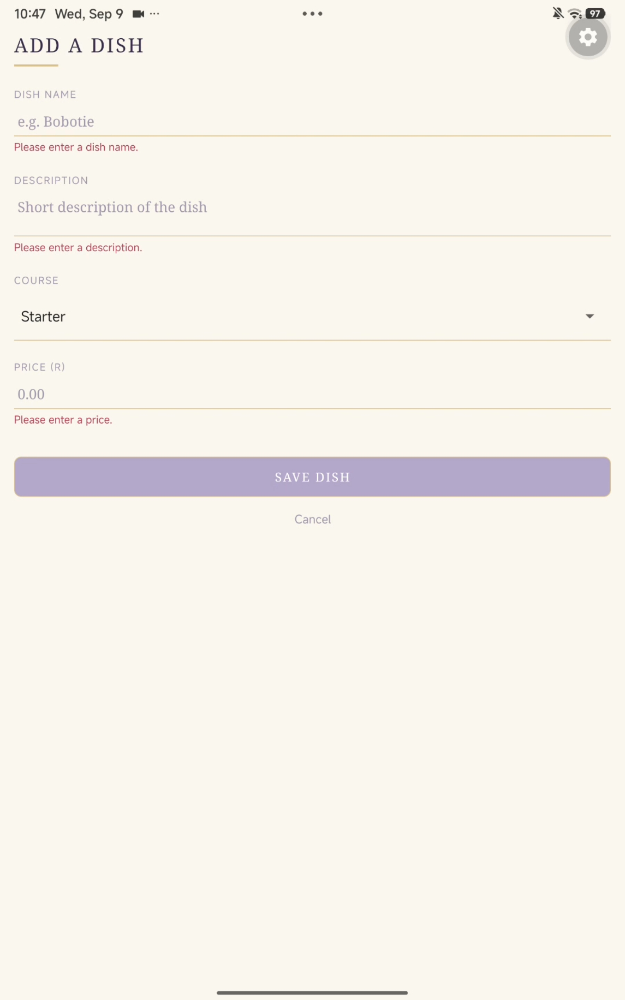

### Validation — Empty Fields
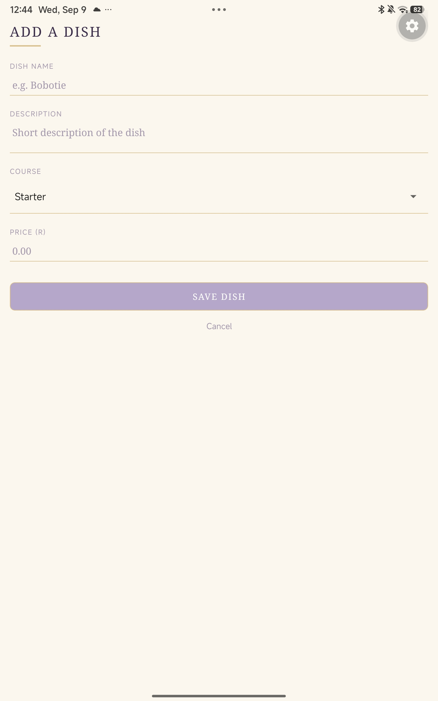

### Menu With All Dishes Added
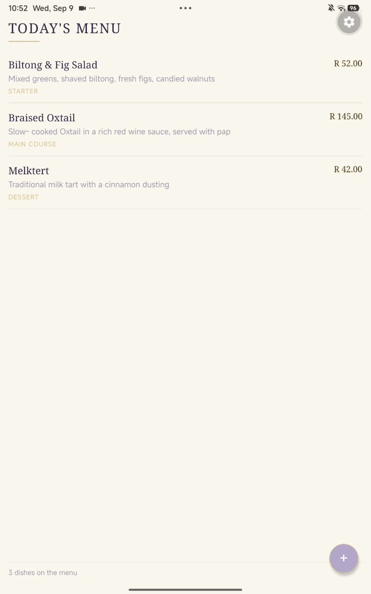

## Tech Stack

- React Native (Expo)
- React Navigation (native stack)
- @react-native-picker/picker

## Design System

Carried over from the Part 1 planning phase — a "Lavender and Champagne" palette, serif headings paired with sans-serif labels, hairline dividers instead of boxed cards, and consistent letter-spaced uppercase headings across every screen.

## How to Run This Project

1. Clone this repository
2. Run `npm install`
3. Run `npx expo start`
4. Scan the QR code with the Expo Go app on an Android device

## Video Demonstration

https://youtu.be/BA3djBubITQ

